<div align="center">

<!-- PORTADA ANIMADA ESTILO TERMINAL (100% SVG PROPIO) -->


<br />

<!-- CONEXIÓN RÁPIDA -->
<a href="https://www.linkedin.com/in/duquemaurodev" target="_blank">
  
</a>
<a href="mailto:duqueivan493@gmail.com">
  
</a>


</div>

---

### `➜ ~ cat about_me.md`

Soy **Desarrollador Full Stack con orientación Backend (+3 años de experiencia)** especializado en diseñar, construir y llevar a producción aplicaciones empresariales con **NestJS, Laravel y React/Next.js**.

Me caracteriza la **propiedad técnica end-to-end**: desde el modelado y optimización de bases de datos, arquitectura de APIs y colas de mensajería, hasta pruebas automatizadas E2E en CI/CD y el despliegue directo sobre **Linux, Docker y Nginx**. Además, conecto la ingeniería con el negocio mediante automatización de procesos (**n8n**) y analítica ejecutiva en tiempo real (**Power BI & Grafana**).

```yaml
arquitectura_y_impacto:
  operacion_regional: ["Colombia 🇨🇴", "Ecuador 🇪🇨", "Perú 🇵🇪"]
  omnicanalidad_prod: "WhatsApp Business API (Meta) + Chatwoot (~7,000 contactos/mes)"
  automatizacion: "+10 flujos críticos en n8n (~160 horas manuales ahorradas/mes)"
  rendimiento_bd: "-75% en tiempos de respuesta de consultas críticas (PostgreSQL / MySQL / MongoDB)"
  calidad_y_ci: "Suites E2E con Playwright (Page Object Model) bloqueando fallos en CI antes de producción"
  datos_para_gerencia: "8 dashboards ejecutivos conectados a bases productivas (Power BI & Grafana)"
```

---

### `➜ ~ ls -la ./proyectos-destacados`

<table>
  <tr>
    <td width="50%" valign="top">
      <h4>🛍️ BANCECLOV — E-Commerce 3D &amp; CRM Propio</h4>
      <p>
        Plataforma de comercio electrónico y gestión comercial end-to-end con visualización interactiva de productos en 3D y arquitectura propia de CRM.
      </p>
      <ul>
        <li><strong>Orquestación de pagos:</strong> Integración en NestJS con pasarela <strong>Bold</strong> (<code>payment</code> &amp; <code>payment-intent</code>).</li>
        <li><strong>CRM a medida:</strong> Inventario, pedidos personalizados, fidelización y reportería.</li>
        <li><strong>Calidad asegurada:</strong> Flujo completo de compra cubierto con pruebas E2E en <strong>Playwright</strong> (local y CI).</li>
      </ul>
      <p>
        <code>Next.js</code> · <code>NestJS</code> · <code>Supabase / PostgreSQL</code> · <code>Three.js</code> · <code>Playwright</code>
      </p>
    </td>
    <td width="50%" valign="top">
      <h4>🤖 Scout — Sistema Multi-Agente de Leads</h4>
      <p>
        Motor automatizado de prospección comercial basado en agentes que detecta oportunidades de negocio reales sin presencia digital.
      </p>
      <ul>
        <li><strong>Arquitectura multi-agente:</strong> Orquestación en TypeScript para descubrimiento, filtrado y enriquecimiento de prospectos.</li>
        <li><strong>Geolocalización de negocios:</strong> Integración directa con <strong>Google Places API</strong> para extracción estructurada.</li>
        <li><strong>Enfoque de negocio:</strong> Generación continua de pipelines comerciales accionables.</li>
      </ul>
      <p>
        <code>TypeScript</code> · <code>Node.js</code> · <code>Multi-Agent Systems</code> · <code>Google Places API</code>
      </p>
    </td>
  </tr>
</table>

---

### `➜ ~ dpkg --list | grep tech-stack`

#### ⚙️ Backend, Arquitectura & Mensajería


#### 🗄️ Bases de Datos & Caché


#### 🎨 Frontend & Experiencia Interactiva


#### 🐳 Infraestructura, Cloud, CI/CD & QA


-0d1117?style=flat-square&logo=playwright&logoColor=2EAD33)
-0d1117?style=flat-square&logo=amazonwebservices&logoColor=FF9900)


#### 🔗 Automatización, Integraciones & Datos/BI


---

### `➜ ~ gh-snake --watch-contributions`

<div align="center">
  <picture>
    <source media="(prefers-color-scheme: dark)" srcset="./assets/github-snake-dark.svg" />
    <source media="(prefers-color-scheme: light)" srcset="./assets/github-snake.svg" />
    
  </picture>
</div>

<br />

<div align="center">
  
</div>
